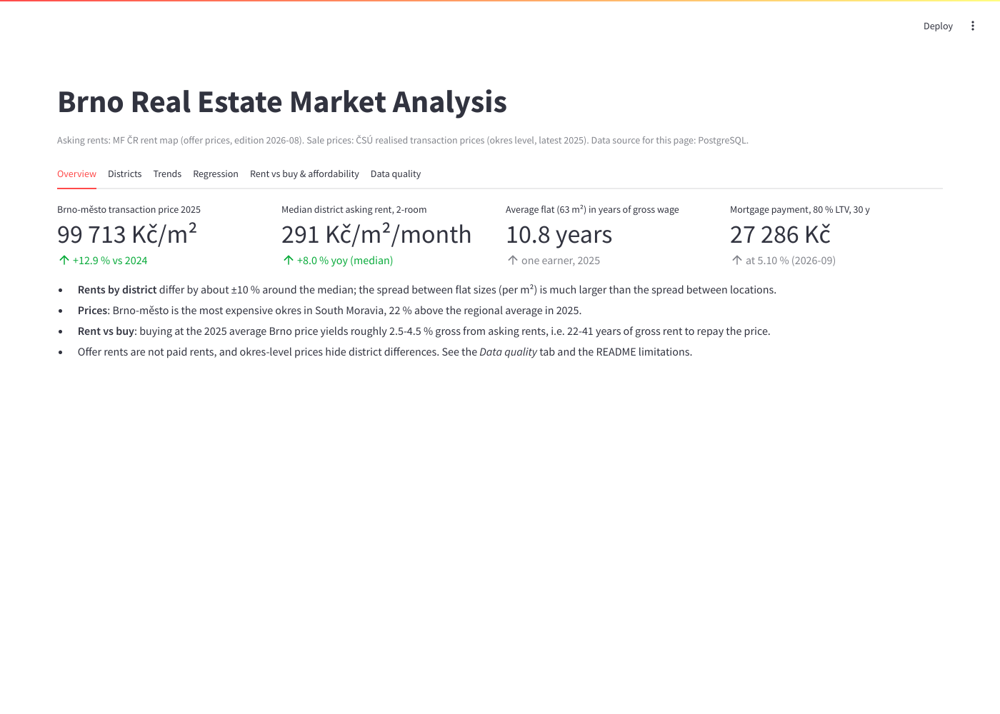
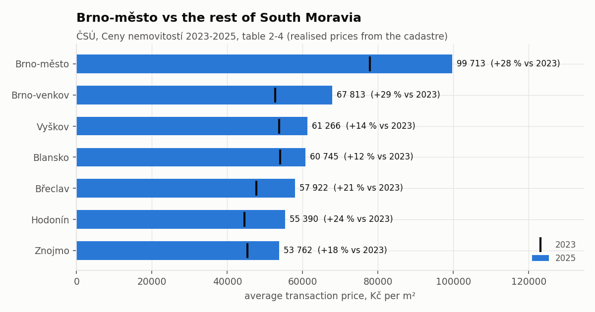
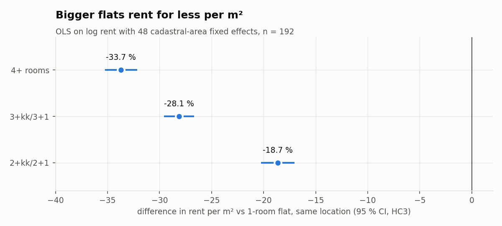
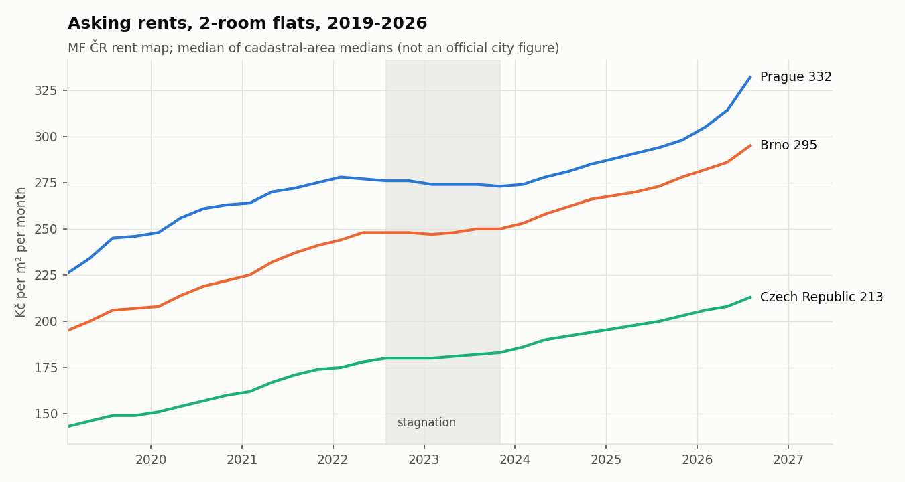
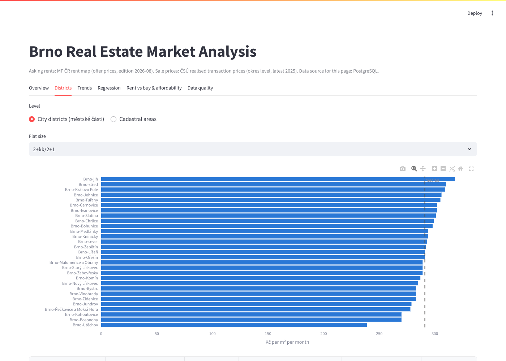
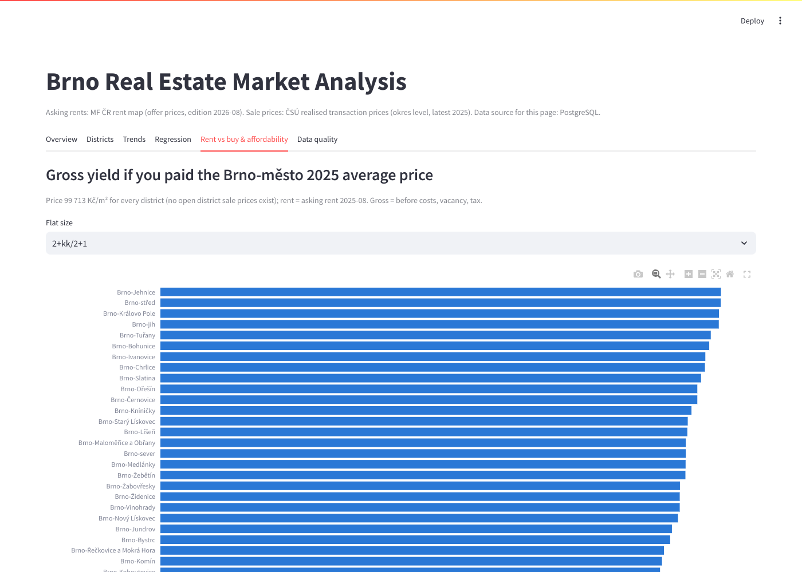
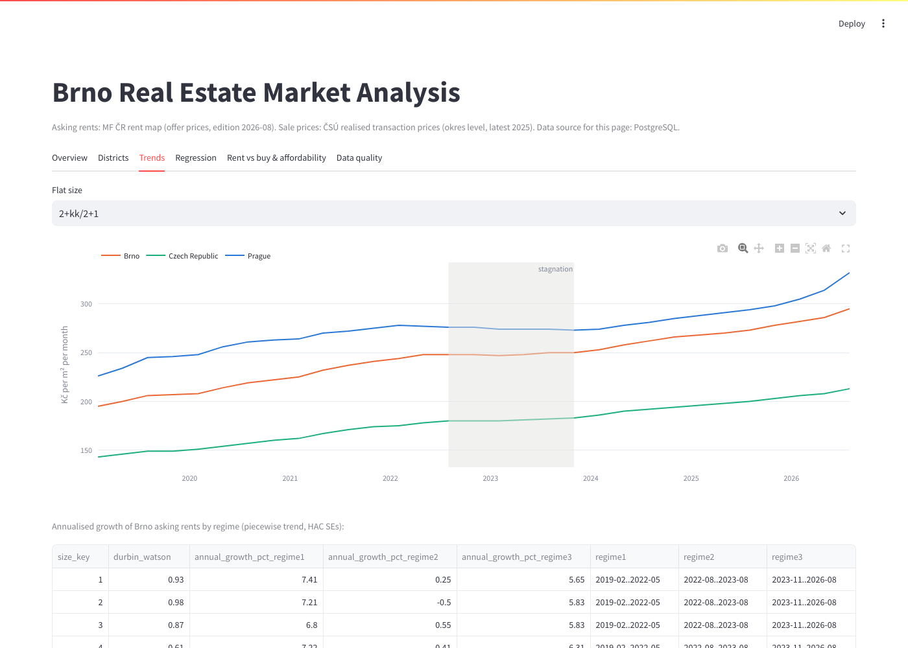
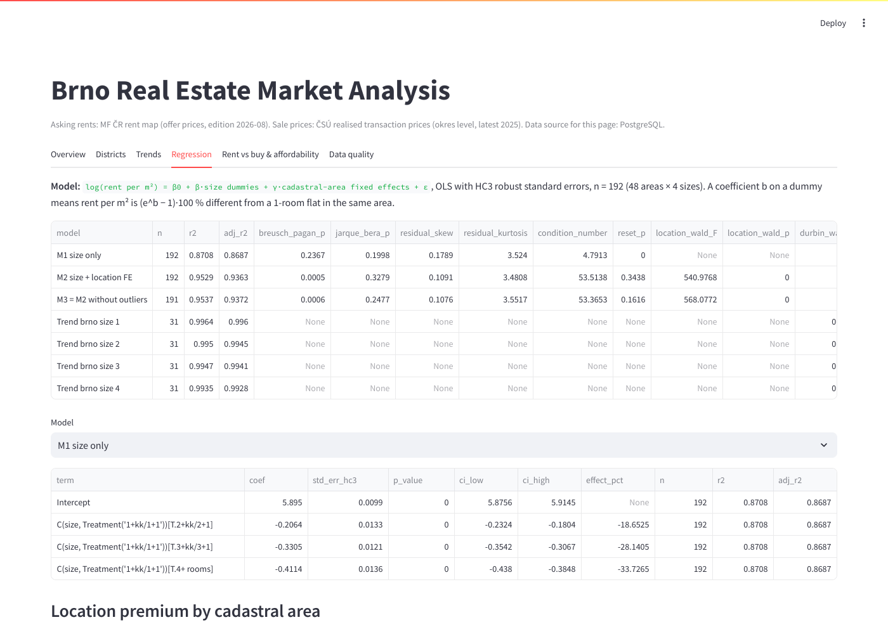

# Brno Real Estate Market Analysis

What does housing in Brno cost — to rent, to buy, and relative to local wages — and what
drives asking rents across the city? An end-to-end data project on **official, openly
licensed data**: Python ETL into PostgreSQL (raw → clean → mart layers), 10 analytical SQL
queries, an econometric model with robust standard errors, and a Streamlit dashboard.



**Stack:** Python 3.12 · pandas · SQLAlchemy 2.0 · PostgreSQL 16 · SQL (CTEs, window
functions, `FILTER`, `PERCENTILE_CONT`, `NTILE`) · statsmodels · matplotlib / Plotly ·
Streamlit · pytest (47 tests) · Ruff · Docker Compose · GitHub Actions

## Questions and how the data shaped them

The original plan was a flat-level hedonic model of **sale** prices (area, floor, condition,
building type by Brno district). Open data for that **does not exist**: listing portals
forbid scraping, no openly licensed Brno listing dataset was found, and official sale prices
are published only down to okres (Brno-město as a whole). Rather than scrape or invent data,
the questions were adapted:

| # | Question | Data used |
|---|---|---|
| 1 | How do rents differ across Brno districts, and how have rents and prices moved over time? | MF ČR rent map (48 cadastral areas, 29 city districts, 2019-2026); ČSÚ price index 2015-2025 |
| 2 | What drives asking rent per m²: flat size or location? | OLS on log rent with location fixed effects (HC3 SEs); piecewise trend (Newey-West SEs) |
| 3 | Rent vs buy: gross yield and payback by district | district rents × ČSÚ Brno-město transaction price |
| 4 | Affordability: an average flat vs wages and mortgage payments | ČSÚ prices + regional wages, ČBA mortgage rates |

Sources, URLs, licences and retrieval dates: **[DATA_SOURCES.md](DATA_SOURCES.md)**.

## Key findings

Full write-up with numbers: [reports/findings.md](reports/findings.md) ·
model output: [reports/regression_report.md](reports/regression_report.md).

**1. Brno-město is South Moravia's price outlier and pulled further ahead.** The average
transaction price reached **99 713 Kč/m² in 2025** (+12.9 % vs 2024, +28.1 % vs 2023), 22 %
above the regional average and ~47 % above the next okres (Brno-venkov, 67 813).



**2. Flat size explains rent per m² more than location does.** Holding the cadastral area
fixed, asking rent per m² is **18.7 % lower for 2-room, 28.1 % lower for 3-room and 33.7 %
lower for 4+ room flats** than for 1-room flats (all p < 0.001, HC3 SEs). Size alone gives
R² = 0.87; adding 48 location effects raises it to 0.95 (location effects jointly
significant, robust Wald F = 541). Location premiums range from about +13 % (Komárov,
Horní Heršpice) to −12 % (Útěchov) around the median area.



**3. Rents went through three regimes.** Brno 2-room asking rents grew ~**7.2 %/yr** from
2019 to mid-2022, were flat (−0.5 %/yr) from 2022-08 to 2023-08 when mortgage rates peaked,
and have grown ~**5.8 %/yr** since late 2023 (piecewise trend, Newey-West SEs). Brno rents
grew slightly faster than Prague's over 2019-2026 (CAGR 5.7 % vs 5.3 %), rising from 86 %
to 89 % of the Prague level per m².



**4. Buying to let gives a thin gross yield.** At the 2025 Brno-město average price, 2025
asking rents imply a gross yield of **~3.2 % for 2-room flats** (range 2.7-3.5 % across
districts; ~31 years of gross rent to repay the price) and ~3.9 % for 1-room flats —
below the 4.6-5.1 % mortgage rates of 2025-2026, before any costs.

**5. An average Brno flat costs ~10.8 years of the average regional gross wage.** For a
63 m² flat at the 2025 price (6.28 M Kč), an 80 % LTV, 30-year mortgage at 4.58 % costs
**25 703 Kč/month = 53 % of one average gross wage** (26.5 % for two earners), versus
~17 200 Kč asking rent for a similar flat, plus a 1.26 M Kč down payment (≈ 26 months of
gross wage). At the September 2026 rate (5.10 %) the payment is 27 286 Kč.

These are descriptive associations on aggregated data, not causal effects — see Limitations.

## Method

1. **Raw** — published files snapshotted in `data/raw/` and loaded unchanged into schema `raw`.
2. **Clean** (`src/cleaning.py`, `src/transform.py`) — Unicode/dash normalisation of
   district names, size-category mapping, Czech number parsing (`89 421`, `4,58`, `x`),
   unit conversion (Kč/m²/month → per year, per flat), duplicates and missing values dropped
   (never imputed), non-positive values rejected, ČSÚ index consistency check. Every step is
   logged with rows removed → [reports/cleaning_log.md](reports/cleaning_log.md).
   **Outlier rule:** |modified z-score| > 3.5 on log rent within flat size (median/MAD,
   Iglewicz-Hoaglin). Outliers are **flagged, not dropped**: 3 of 308 rows; model M3 re-fits
   without them and the coefficients do not change materially.
3. **Mart** (`sql/marts.sql`) — rankings, yoy growth (`LAG`), indices (`FIRST_VALUE`).
   Clean tables have primary keys and `CHECK` constraints (`sql/schema.sql`).
4. **SQL analysis** — 10 queries in `sql/queries/`, each headed by the question it answers.
5. **Models** (`src/analysis.py`) — `log(rent) ~ size + area FE`, HC3 SEs, Breusch-Pagan,
   Jarque-Bera, RESET, robust Wald test; piecewise log-linear trend with HAC SEs.
6. **Dashboard** (`app/dashboard.py`) — reads the mart from Postgres (falls back to the
   processed CSVs), includes a mortgage calculator.

The cleaning steps removed **0 rows** from the real data (it is published, curated
statistics); the rules are still enforced and unit-tested on synthetic edge cases.

## Limitations

- **Asking ≠ paid.** Rents are MF ČR model estimates from listings (offer prices); paid
  rents are usually lower. Sale prices are realised transaction prices — the two are
  different kinds of measure, so yields are indicative.
- **No district sale prices.** Yields by district use one city-wide price; they differ
  only through rent and are "if you paid the Brno average here", not measured yields.
- **Aggregated data, no flat attributes.** Floor, condition, building type and exact area
  are unavailable, so the model cannot separate them; location effects may partly reflect
  the mix of new-build vs older stock in each area (selection, not location value).
- **Correlation, not causation.** The trend regimes coincide with the 2022-2023 rate
  shock, but the model does not identify the cause.
- **Time coverage & matching.** Prices: 2023-2025 (okres), index to 2025 Q4. Rents:
  2019-2026. 2025 district rents are backed out from the published yoy change. Wages are
  regional (Jihomoravský kraj), averages not medians (the median is lower), gross not net.
- **Small n for the cross-section** (192 rows) and city aggregates are medians of
  medians, not official city figures.
- Values were transcribed from published tables (see DATA_SOURCES.md cross-checks).

## Run it

Requires Docker Desktop. From Git Bash:

```bash
git clone https://github.com/Kerya27/brno-real-estate-analysis.git && cd brno-real-estate-analysis
docker compose up --build        # Postgres 16 + pipeline + dashboard → http://localhost:8501
```

Local Python instead of the containers (Postgres still from Compose, port 5433):

```bash
python -m venv .venv && source .venv/Scripts/activate && pip install -r requirements-dev.txt
docker compose up -d db && python -m src.pipeline   # loads raw/clean/mart, writes reports
streamlit run app/dashboard.py                       # dashboard; `ruff check . && pytest` for tests
```

Settings live in `.env` (copy `.env.example`; defaults work without it).

## Repository layout

```
data/raw/            source snapshots (small CSVs)        data/processed/  pipeline outputs
src/                 ingest, cleaning, transform, load, analysis, charts, pipeline
sql/                 schema.sql (clean layer), marts.sql, queries/01-10
app/dashboard.py     Streamlit                            reports/         findings, logs, figures
tests/               47 pytest tests (cleaning, models, Postgres integration)
docs/screenshots/    dashboard screenshots                STUDY_GUIDE.md   explanation + interview Q&A
```

## Dashboard

| Districts | Rent vs buy & mortgage calculator |
|---|---|
|  |  |
| **Trends** | **Regression** |
|  |  |

## Choices made

- **Streamlit** for the dashboard, as specified. Power BI appears in many Czech analyst job
  ads, but I could not measure demand reliably, so it is a possible next step (the mart
  tables are ready to connect).
- Pipeline runs from committed snapshots for reproducibility; `python -m src.ingest`
  refreshes the rent map. Postgres is published on host port **5433** to avoid clashing
  with a local Postgres. Fixed seed (42) for synthetic test data. Dependencies pinned.

Data: © MF ČR / Brno pod lupou (CC BY 4.0), ČSÚ, ČBA — see DATA_SOURCES.md.
